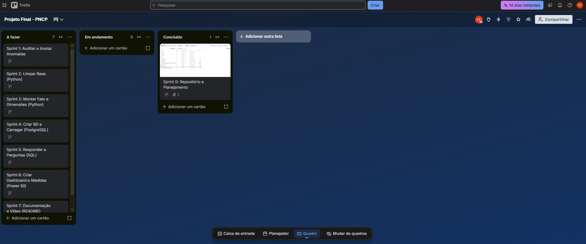

# 📊 Análise de Dados com Python e PostgreSQL - Controladoria
### Situação de Aprendizagem (Projeto Avaliativo) - Módulo 2 - Semana 13

Este projeto visa desenvolver uma esteira analítica ponta a ponta para tratar, modelar e visualizar dados de compras públicas do Portal Nacional de Contratações Públicas (PNCP), identificando anomalias e respondendo a perguntas estratégicas da Controladoria. 


## 1. O Contexto do Problema
 
   O Portal Nacional de Contratações Públicas (PNCP) centraliza os dados de compras do governo, porém os sistemas legados geram bases repletas de anomalias. A missão deste projeto foi extrair, higienizar e modelar esses dados para criar um ambiente analítico auditável. O objetivo final é permitir a auditoria de gastos, análise de economia (deságio) e o monitoramento do ciclo de compras governamentais através de um pipeline automatizado e painéis de Business Intelligence.

Nota: Este case foi desenvolvido como desafio final para a certificação na Trilha de Análise de Dados do programa SCTec (Carreira Tech). 
   

## 2. Decisões Técnicas Adotadas

Para garantir a confiabilidade dos dados e a performance do painel final, as seguintes decisões arquiteturais e de negócios foram aplicadas:

* **Sanitização "Shift-Left" em Python (Pandas):** 
 O tratamento de dados corrompidos (CNPJs com zeros perdidos, formatos mistos e nulos disfarçados) foi executado no início do pipeline. Isso impediu que dados inválidos chegassem à base, garantindo que o PostgreSQL recebesse apenas informações tipadas e validadas.

* **Modelagem Dimensional (Star Schema):** 
No banco de dados (PostgreSQL), os dados foram distribuídos fisicamente em 1 tabela Fato e 4 Dimensões para garantir integridade referencial e eficiência de armazenamento. Já no Power BI, a modelagem foi expandida com a criação de uma dimensão Calendario dinâmica em DAX (para suportar análises de inteligência temporal precisas, substituindo hierarquias automáticas) e uma tabela dedicada exclusivamente para as medidas analíticas, garantindo organização e alta performance na renderização do painel.

* **Arquitetura/Carga Idempotente (Batch) com DROP/CREATE, sem uso de TRUNCATE**
O pipeline foi desenhado para ser 100% idempotente utilizando a função `banco.recriar_banco()` , que atua como um "reset" total, apagando (DROP) e recriando o banco do zero antes de executar o script DDL 01_criar_banco.sql. Como as tabelas já nascem completamente limpas antes da inserção dos dados, o uso do comando TRUNCATE tornou-se desnecessário. Isso garante que a carga (python -m src.carregar) possa ser rodada inúmeras vezes sem qualquer risco de duplicação, entregando sempre as exatas 6.126 linhas na tabela fato_item_contratado.

* **Aderência às Regras da Controladoria:**
 Todas as diretrizes de cálculo (grão da fato, critérios de desempate, cálculo de economia) foram aplicadas integralmente. Isso garantiu o sucesso na validação cruzada com a "prova real". A aplicação rigorosa das regras (descarte de resultados cancelados, desempate pelo menor sequencial e rejeição de itens com valores absurdos) garantiu a correspondência de 100% com a prova real da auditoria. Não houve discordância em relação às regras propostas.0

* **Classificação de Obras via Expressões Regulares (RegEx):** 
  Utilizamos a técnica de limite de palavra (`\b` (word boundary)) no Python para definir o perfil de gastos sem falsos positivos. Aplicando as palavras-chave `\bobra\b`, `\bconstrução\b`, `\breforma\b` e `\bengenharia\b`, garantimos que palavras como "cobrança" ou "dobradiça" não fossem erroneamente classificadas como obras de engenharia garantindo uma categorização exata de acordo com as regras da Controladoria.

* **Aderência Estrita às Regras de Controladoria:** 
  * **Por quê:** Decidimos não   nenhuma regra de negócio. O descarte de resultados cancelados (SRP), o desempate pelo menor sequencial e a rejeição implacável de 99 itens com "dados impossíveis" (ex: quantidades zeradas ou valores totais acima de R$ 1 trilhão) garantiram a correspondência de 100% com a prova real da auditoria.
  
##  3. Dicionário das Inconsistências Tratadas (Auditoria)

Durante a auditoria inicial da base bruta, mapeamos as anomalias exigidas pela Controladoria. Foram realizados registros desta auditoria. Aplicamos os seguintes tratamentos no pipeline em Python:

* **1. Volumetria e Duplicidade de Chaves**
  * **Descoberta:** O arquivo `compras.csv` possui **2.042 linhas** e a chave `numero_controle_pncp` **não possui repetições**. O arquivo `itens.csv` possui **7.077 linhas** e o `resultados.csv` conta com **15.896 linhas**.
  * **Tratamento:** Como a integridade da chave primária em `compras.csv` foi confirmada na origem, a tabela pôde ser validada de forma segura para compor as dimensões do nosso Modelo Estrela.

* **2. Formatos de Dinheiro, Data e CNPJ**
  * **Descoberta:** 
    * *Dinheiro:* `resultados.csv` mistura padrão numérico (`19290383.46`) e texto formatado (`R$ 3.718.205,52`). 
    * *Data:* Existem múltiplos padrões (`2025-01-06T11:51:06`, `02/01/2025 09:03` e `02.01.2025`). 
    * *CNPJ:* Perda de zeros à esquerda na tipagem (ex: `119784000171`).
  * **Tratamento:** Aplicação da máscara `.zfill(14)` para corrigir CNPJs; remoção da string "R$" e conversão para numérico (`float`); e padronização de todas as datas para o formato ISO via `pd.to_datetime()`.

* **3. Nulos Disfarçados (N/A, -, 0, vazio)**
  * **Descoberta:** Identificados em peso afetando as colunas `situacao_item` (85 casos em `itens.csv`) e `objeto_compra` (`compras.csv`).
  * **Tratamento:** Substituição lógica desses falsos preenchimentos por nulos autênticos (`NaN`), impedindo que o banco de dados classificasse lixo como informação válida.

* **4. Textos com Acento Quebrado (ç, ã)**
  * **Descoberta:** Sim, existem. Mapeamos **167 ocorrências** na coluna `objeto_compra` (`compras.csv`) e **212 ocorrências** na coluna `descricao` (`itens.csv`).
  * **Tratamento:** Rotina de sanitização textual para corrigir falhas de encoding e uniformizar a grafia das descrições.

* **5. Inconsistência Cronológica e Dados Impossíveis**
  * **Descoberta:** O cruzamento revelou **1.056 casos** onde a data de homologação (`data_resultado`) era anterior à `data_publicacao`. Além disso, foram detectados itens com valores zerados, negativos ou totais acima de R$ 1 trilhão.
  * **Tratamento:** Itens com cronologia invertida tiveram seu ciclo de compras anulado para não corromperem a média de tempo no painel. Além disso, **99 itens** foram sumariamente rejeitados do banco por conterem dados matematicamente impossíveis : quantidades zeradas, negativas ou nulas, valores unitários ou totais negativos, ou orçamento sigiloso, valores totais homologados maiores que 1.000 vezes o estimado ou acima de R$ 1 trilhão

 
Acesso em : [Conferência](docs/conferencia/conferencia_modalidades)
 [Conferências Sprint 3](docs/conferencia/conferencia_sprint3.txt)
 [Conferências Sprint 4](docs/conferencia/conferencia_sprint4.txt)

#### Conferência Modalidade:
| Modalidade                | Volume Homologado (R$) | Participação (%) |
|---------------------------|-----------------------:|-----------------:|
| Concorrência - Eletrônica |   4.700.493.122,98     |           58,43% |
| Credenciamento            |   2.141.301.557,16     |           26,62% |
| Pregão - Eletrônico       |     502.223.491,28     |            6,24% |
| Concorrência - Presencial |     444.752.757,18     |            5,53% |
| Inexigibilidade           |     213.365.238,19     |            2,65% |
| Dispensa                  |      39.887.350,44     |            0,50% |
| Pregão - Presencial       |       2.475.288,51     |            0,03% |

#### Indicadores:
| INDICADORES PRINCIPAIS DO DW                | VALOR                  |
|---------------------------------------------|-----------------------:|
| Itens na Tabela Fato                        |                  6.126 |
| Contratações Distintas                      |                  1.962 |
| Fornecedores                                |                  2.652 |
| Órgãos (CNPJ)                               |                    363 |
| Volume Homologado                           | R$ 8.044.498.805,74    |
| Itens Comparáveis (Base de Deságio)         |                  5.457 |
| Economia Média (Deságio)                    |                 14,46% |
| Ciclo Médio / Máximo (Dias)                 |             48,1 / 611 |
| Itens sem Ciclo Válido                      |                    230 |

#### Gastos:
| PERFIL DE GASTOS (% DO VOLUME)              | PARTICIPAÇÃO (%)       |
|---------------------------------------------|-----------------------:|
| Obras e Engenharia                          |                 60,80% |
| Serviços                                    |                 36,60% |
| Bens                                        |                  2,60% |

#### Indicadores Complementares:
| INDICADORES COMPLEMENTARES                  | VALOR                  |
|---------------------------------------------|-----------------------:|
| Itens sem Resultado Homologado              |                    852 |
| Soma do Valor Estimado (Todos)              | R$ 32.629.639.732,13   |
| Estimado (Base Comparável)                  | R$ 6.867.663.469,91    |
| Economia Nominal (Base Comparável)          | R$ 992.861.686,95      |
| Itens com Sobrepreço                        |                     27 |
| Itens com Ciclo Válido                      |                  5.896 |

#### Linhas:
| NOME DA TABELA         | LINHAS CARREGADAS | LINHAS ESPERADAS | STATUS  |
|------------------------|------------------:|-----------------:|--------:|
| fato_item_contratado   |             6.126 |            6.126 |   ✅ OK |
| dim_fornecedor         |             2.652 |            2.652 |   ✅ OK |
| dim_orgao              |               363 |              363 |   ✅ OK |
| dim_localidade         |                27 |               27 |   ✅ OK |
| dim_modalidade         |                 7 |                7 |   ✅ OK |


## 4. Diagrama da Modelagem Dimensional
O banco de dados segue um Modelo Estrela otimizado para consultas analíticas. O grão da tabela fato é **uma linha por item de contratação** (`numero_controle_pncp` + `numero_item`).

[Diagrama da Modelagem Dimensional](docs/img/modelo_estrela_final.png)

  

## 5. Técnicas e Tecnologias Utilizadas

* **Python (Pandas):** Extração, limpeza e transformação de dados (ETL).
* **PostgreSQL & pgAdmin 4 :**  Armazenamento relacional e integridade de restrições (Constraints/PK/FK), com administração e execução de scripts SQL validados diretamente pela interface do pgAdmin.
* **SQL:** SQL: Consultas analíticas e validação de métricas de negócio exigidas pela Controladoria.
* **Power BI & DAX:** : Visualização de dados, criação de painéis executivos com navegação interativa (bookmarks e tooltips contextuais), elaboração de Calendário dinâmico e desenvolvimento de mais de 15 medidas analíticas avançadas para responder diretamente às regras de negócio. Visualização de dados e criação de dashboards.
* **Visual Studio Code (VS Code), Git & GitHub:** Ambiente de Desenvolvimento Integrado (IDE) utilizado para a escrita de todo o código, gerenciamento do ambiente virtual (venv) e orquestração do versionamento para o repositório na nuvem.


## 6. Instruções de Execução

 **1. Clone o repositório:**
```bash
git clone https://github.com/Clacops/pncp-controladoria.git
cd pncp-controladoria
```


 **2. Crie e ative o ambiente virtual (VENV):**
No Windows:

```Bash
python -m venv venv
venv\Scripts\activate
```
No Linux/Mac:

```Bash
python3 -m venv venv
source venv/bin/activate
```
**3. Instale as dependências do projeto:**
```bash
pip install -r requirements.txt
```
**4. Configure o Banco de Dados (PostgreSQL):**

* Renomeie o arquivo .`env.example` para `.env`.
* Abra o arquivo `.env` e preencha com as suas credenciais locais de acesso ao pgAdmin/PostgreSQL (usuário, senha, porta).

**5. Execute o Pipeline ETL:**
* O comando abaixo fará a criação do banco de dados (idempotente), extração, limpeza e carga dos dados:
```bash
python -m src.carregar
```

##  Estrutura do Projeto


```text
Projeto_Final_Modulo_2/
├── data/
│   └── raw/                   # Arquivos CSV brutos fornecidos (compras, itens, resultados)
├── docs/
│   ├── conferencia/           # Logs e arquivos de texto com as validações de volumetria
│   └── img/                   # Imagens do README (modelo estrela e prints das Sprints)
├── powerbi/                   # Arquivo .pbix com o dashboard executivo
├── sql/
│   ├── 01_criar_banco.sql     # DDL de criação das tabelas Fato e Dimensões
│   ├── 02_perguntas.sql       # Consultas analíticas respondendo às regras de negócio
│   └── 03_validacao_pbi.sql   # Consultas de "prova real" para os indicadores do dashboard
├── src/                       # Scripts Python de extração, limpeza e carga
│   ├── banco.py
│   ├── carregar.py
│   ├── config.py
│   ├── limpeza.py
│   └── montar_tabelas.py
├── .env.example               # Template de variáveis de ambiente
├── .gitignore                 # Arquivos ignorados pelo Git (.env, venv, pycache)
├── README.md                  # Documentação do projeto
└── requirements.txt           # Dependências do Python (pandas, psycopg2, etc)
```
## 7. Planejamento e Execução (Sprints)

O desenvolvimento do pipeline e do dashboard foi estruturado em Sprints, garantindo entregas contínuas, organização ágil e o cumprimento de todos os requisitos do edital SCTec. 

Abaixo está o quadro detalhado do nosso planejamento e evolução ao longo das etapas:

## 🏃‍♂️ Gestão Ágil e Sprints


| Sprint | Etapa do Pipeline | Status |
| :--- | :--- | :--- |
| **Sprint 0** | Repositório e Planejamento | Criar o repositório, preparar a ferramenta de gestão visual (pastas e arquivos) e compreender os dados Data:17/10/2026 ✅ Concluído |
| **Sprint 1** | Auditar e Anotar Anomalias | Contar os problemas da base e anotar no ficheiro README.md cada anomalia e quantos registos ela afeta Data:17-18/10/2026 ✅ Concluído |
| **Sprint 2** | Limpar Base (Python) |Tratar e limpar os dados com Python no ficheiro limpeza.py Data:17-18/10/2026 ✅ Concluído |
| **Sprint 3** | Montar Fato e Dimensões (Python)   |Montar ficheiro: montar tabelas_py Data:18-19/10/2026 ✅ Concluído
| **Sprint 4** | Criar BD e Carregar (PostgreSQL) |Escrever SQL e carregar os dados para o PostgreSQL Data:19/10/2026 ✅ Concluído
| **Sprint 5** | Responder a Perguntas (SQL) | Responder às perguntas de negócio com queries SQL e Power BI Data:20-21/10/2026✅ Concluído
| **Sprint 6** | Criar Dashboard e Medidas (Power BI) | Criar o Dashboard no Power BI com as 15 e medidas e as extras Data:21-22/10/2026  ✅ Concluído
| **Sprint 6 Extra**| Revisão de Requisitos e Prova Real |Realizar revisao dos requisitos e conferência da “prova real” final Data:22/10/2026 ✅ Concluído
| **Sprint 7** | Documentação e Vídeo (README)  | Fechar o README, revisao dos  atingimento dos critérios de avaliação. Gravar o vídeo de 7 minutos e partilhar os links Data:23/10/2026 ✅ Concluído
 

 

 ## 8. Melhorias Futuras

Embora o pipeline atual atenda integralmente aos requisitos do edital, as seguintes evoluções estão mapeadas para o amadurecimento do projeto:

* **Automação e Orquestração:** Implementação do Apache Airflow para agendamento e monitorização automatizada das rotinas de extração e carga (ETL).

* **Migração para Cloud:** Alojar o banco de dados PostgreSQL numa infraestrutura em nuvem (como a Google Cloud Platform), garantindo maior escalabilidade e facilitando a atualização automática do painel no Power BI.

* **Análise Preditiva:** Aplicação de modelos preditivos com Python (Scikit-Learn) para estimar o tempo de ciclo de futuras licitações e identificar anomalias ou sobrepreços de forma proativa.