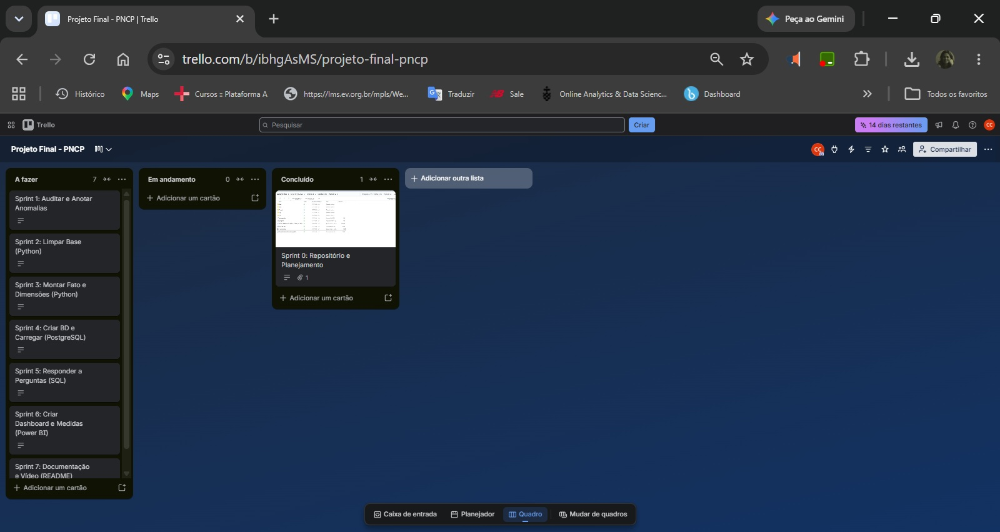

# Análise de Dados com Python e PostgreSQL - Controladoria

## Contexto
Este projeto visa desenvolver uma esteira analítica ponta a ponta para tratar, modelar e visualizar dados de compras públicas do Portal Nacional de Contratações Públicas (PNCP), identificando anomalias e respondendo a perguntas estratégicas da Controladoria. Faz parte de projeto avaliativo do curso Carreira Tech - Trilha Análise de dados - SCTEC

## Planejamento em Sprints  
 

A divisão exata sugerida no guião é a seguinte: 
•	Sprint 0 (Planeamento): Criar o repositório, preparar a ferramenta de gestão visual (quadro ou linha do tempo) e entender os dados. (O que já fez ao configurar o VS Code e as pastas). 
•	Sprint 1 (Auditoria): Contar os problemas da base e anotar no ficheiro README.md cada anomalia e quantos registos ela afeta. (O que acabámos de realizar com o script exploratório anterior). 
•	Sprint 2 (Limpeza): Completar as funções no ficheiro src/limpeza.py para corrigir os erros detetados. 
Preencha as linhas seguindo o guião do projeto: 
•	Sprint 0: Estruturar repositório e planear o projeto (Status: Concluído).
•	Sprint 1: Auditar a base de dados (Status: Concluído).
•	Sprint 2: Tratar e limpar os dados com Python no ficheiro limpeza.py (Status: A Fazer).
•	Sprint 3: Montar a Fato e as Dimensões no ficheiro montar_tabelas.py (Status: A Fazer).
•	Sprint 4: Escrever SQL e carregar os dados para o PostgreSQL (Status: A Fazer).
•	Sprint 5: Responder às perguntas de negócio com queries SQL (Status: A Fazer).
•	Sprint 6: Criar o Dashboard no Power BI com as 15 medidas (Status: A Fazer).
•	Sprint 7: Fechar o README, gravar o vídeo de 7 minutos e partilhar os links (Status: A Fazer).

## Dicionário de Anomalias (Auditoria Inicial - Sprint 1)

Durante a auditoria exploratória dos dados brutos do PNCP (ano de 2025), foram identificadas as seguintes inconsistências estruturais que exigem tratamento:

* **compras.csv (2.042 linhas):** 
  * Não há chaves duplicadas (`numero_controle_pncp`). 
  * **CNPJ:** Perda de zeros à esquerda devido a conversões de tipo (ex: '119784000171'). Órgãos com o mesmo nome apresentam múltiplos CNPJs (unidades).
  * **Datas:** Violação de integridade de formato em `data_publicacao`, misturando padrões como `2025-01-06T11:51:06`, `02/01/2025 09:03` e `02.01.2025`.
  * **Encoding:** Caracteres corrompidos (Latin-1/UTF-8) no campo `objeto_compra` (167 ocorrências).

* **itens.csv (7.077 linhas):**
  * **Nulos Disfarçados:** Existência de strings mascarando dados nulos (como 'N/A', '-', '0', 'SEM INFORMAÇÃO'). A coluna `situacao_item`, por exemplo, apresenta 85 casos.
  * **Encoding:** Problemas de acentuação quebrada na `descricao` (212 ocorrências).

* **resultados.csv (15.896 linhas):**
  * **Padrões Monetários:** Valores preenchidos como texto livre misturados com números (ex: `19290383.46` vs `R$ 3.718.205,52`), com inversão de separadores de milhar e decimal.
  * **Cronologia Impossível:** O cruzamento das bases revelou **1.056 casos** onde a data de homologação (`data_resultado`) é anterior à `data_publicacao` do edital.